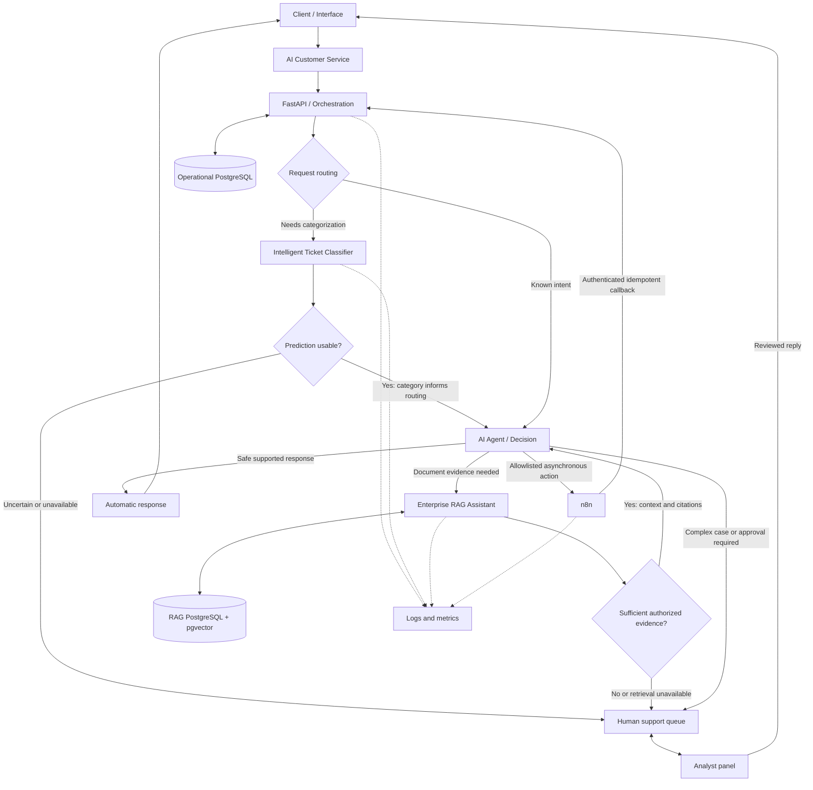

# Proposed integrated ecosystem

[Portfolio](../../README.md) · [Contracts](integration-contracts.md) · [Decisions](architecture-decisions.md)

Status: Planned. All service nodes represent proposed components.

The arrows show logical request/result dependencies, not a mandatory linear pipeline. The RAG return to the decision node is bounded to one retrieval attempt per turn initially; unresolved questions go to humans. Direct routine responses can bypass both ML and RAG. Agent actions with external side effects require policy checks and human approval where appropriate.

## Responsibility boundaries

| Component | Owns | Does not own |
| --- | --- | --- |
| Customer Service | Validation, conversation history, routing, assignment/reassignment, audit and response policy | Model training or document indexing |
| Ticket Classifier | Dataset pipeline, inference, model version and uncertainty policy | Customer actions or answer generation |
| Enterprise RAG | Authorized ingestion, retrieval, citations and evidence sufficiency | Ticket lifecycle or account mutations |
| n8n | Asynchronous notifications and approved workflow execution | Final authorization decisions |
| Analyst panel / Lovable interface | Human review and authorized UI interactions through APIs | Direct database access or client-side secrets |

Each service owns its data and credentials. Operational and knowledge databases may share an initial PostgreSQL server with separate databases and roles; services communicate through APIs rather than cross-service SQL.

## Failure behavior

- Classifier timeout or incompatible schema: mark classification unavailable and queue review; never invent a category.
- RAG timeout, stale index or insufficient authorized evidence: abstain or hand off; never present unsupported content as sourced.
- LLM outage or malformed tool arguments: stop tool execution, record a sanitized error and route to a human.
- n8n duplicate callbacks: deduplicate with event identifiers; failed delivery uses bounded retries and a review queue.
- Operational database outage: return a retryable service error; do not claim a ticket or assignment was saved.
- Analyst queue outage: preserve durable pending work where possible and expose pending status; never claim a human accepted it.
- Telemetry outage: buffer within limits without logging secrets; security audit persistence failure blocks sensitive state changes.

Proposed telemetry covers request latency, error rate, handoff rate, evidence coverage and workflow failures. These are planned measurements, not observed results.
